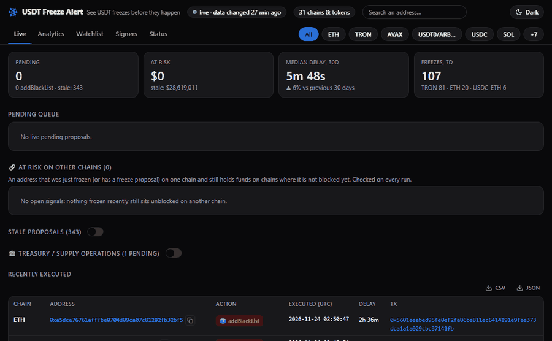
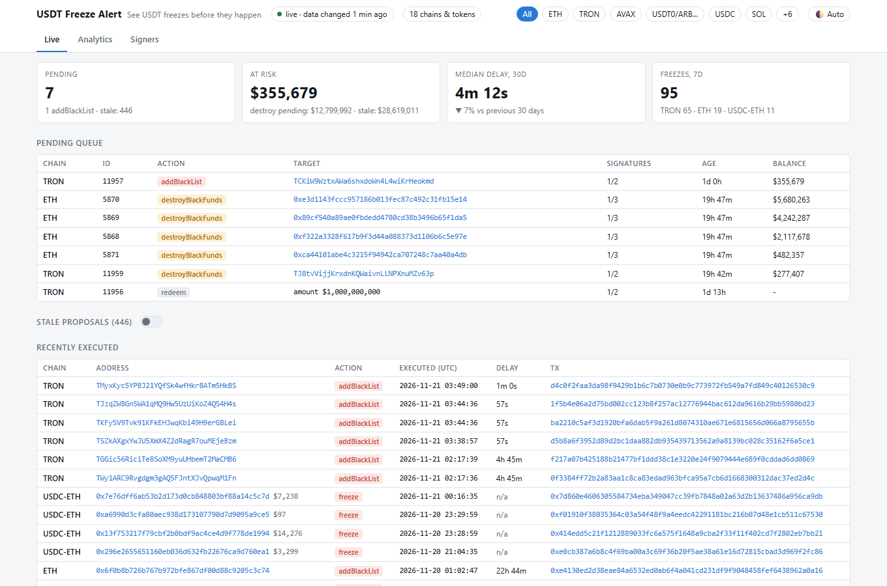
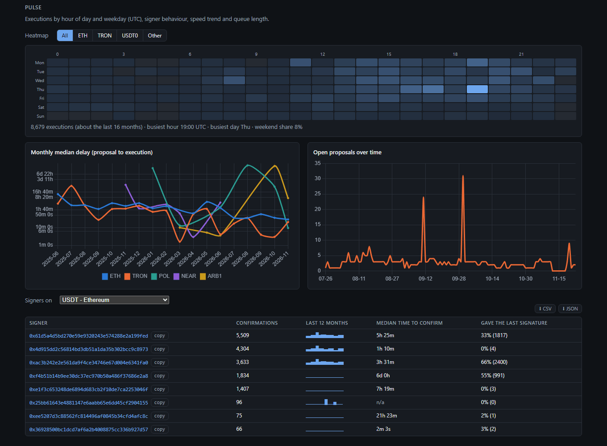
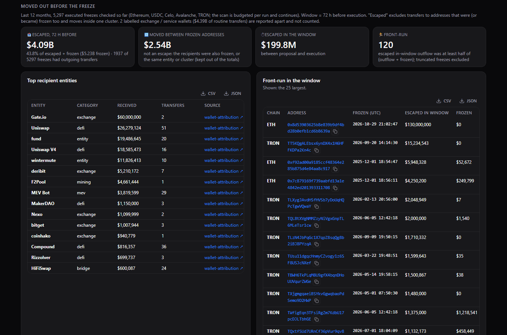
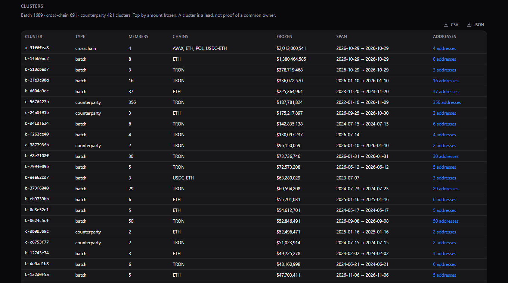
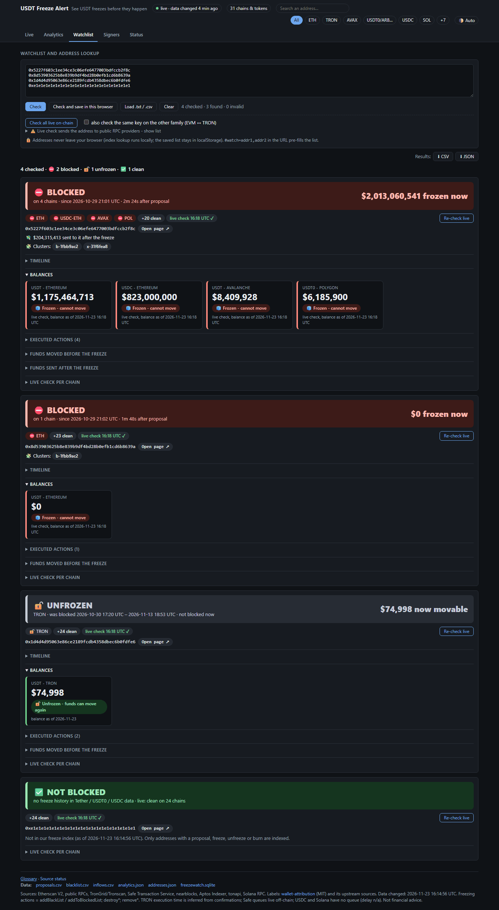
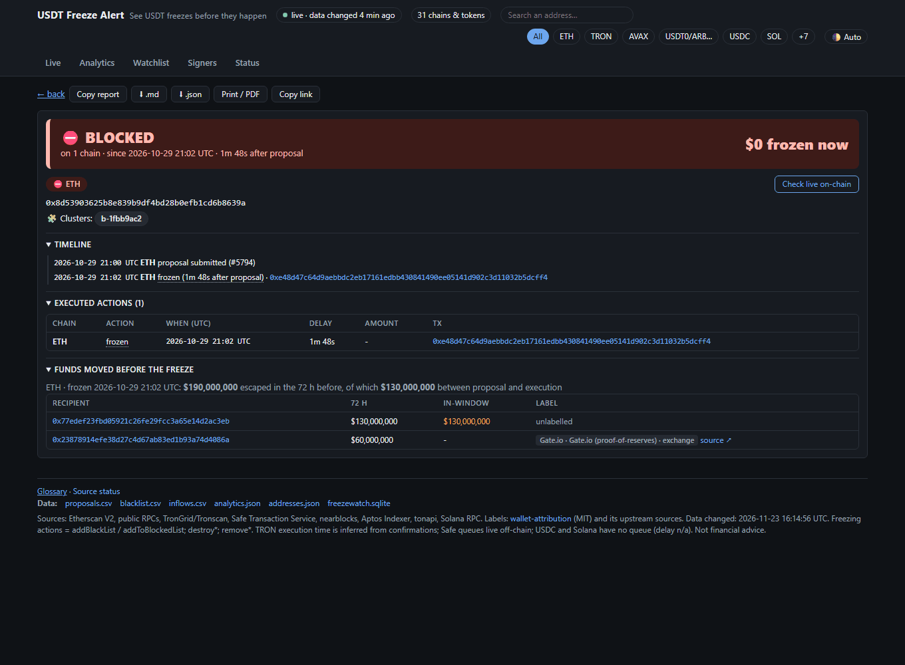
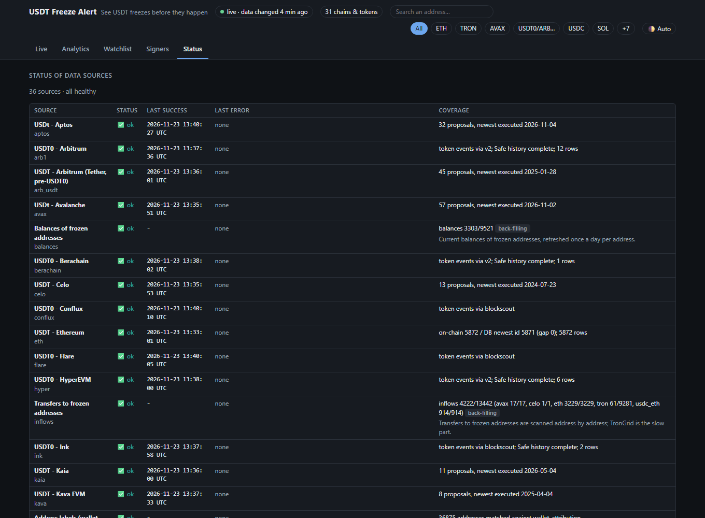
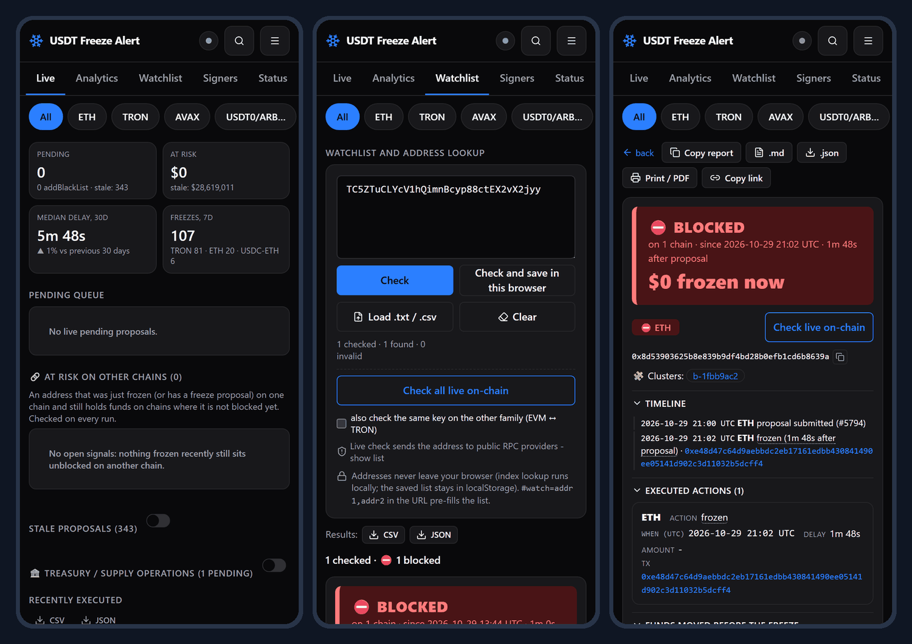
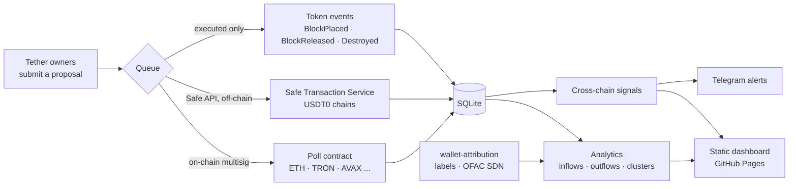

<p align="center"></p>

<p align="center">
  <a href="https://github.com/prettydeath/usdt-freeze-alert/actions/workflows/ci.yml"></a>
  <a href="https://github.com/prettydeath/usdt-freeze-alert/actions/workflows/watch.yml"></a>
  
  
  
  
  <a href="https://t.me/usdt_freeze_alert"></a>
</p>

<h3 align="center">Watch Tether's freeze queue on 30+ chains. See the proposal before the address is frozen.</h3>

<p align="center"><b><a href="https://prettydeath.github.io/usdt-freeze-alert/">Live dashboard</a></b> · <a href="https://t.me/usdt_freeze_alert">Telegram alerts</a> · <a href="CHANGELOG.md">Changelog</a></p>

<p align="center">
  
  
  
  
  
</p>

<p align="center"></p>

## Why

- **See freezes before they execute.** Tether freezes through multisig wallets, and the proposal is public first. Every queue is polled, signatures are counted, and the wait between *proposed* and *executed* is measured.
- **Early cross-chain signals.** An address frozen on one chain that still holds USDT, USDT0 or USDC on another chain where it is *not* blocked yet becomes a signal, with the lag until the second chain follows.
- **Where the money went.** Outgoing transfers in the 72 hours before each freeze, split into funds that escaped, funds moved between addresses that were frozen too, and funds moved between proposal and execution (front-run).

## What you get

<table>
<tr>
<td width="50%"><a href="assets/dashboard-dark.png"></a><br><sub><b>Live</b>: pending queue, at-risk signals, recent executions</sub></td>
<td width="50%"><a href="assets/dashboard-light.png"></a><br><sub>Light theme, same data</sub></td>
</tr>
<tr>
<td><a href="assets/analytics-dark.png"></a><br><sub><b>Analytics</b>: frozen / burned / sent after freeze, by chain and period</sub></td>
<td><a href="assets/pulse-dark.png"></a><br><sub><b>Pulse</b>: execution heatmap, signer speed, median delay, queue length</sub></td>
</tr>
<tr>
<td><a href="assets/outflows-dark.png"></a><br><sub><b>Funds moved before the freeze</b>: escaped vs internal, front-run list, cross-chain lag</sub></td>
<td><a href="assets/clusters-dark.png"></a><br><sub><b>Clusters</b>: batches, cross-chain and shared-counterparty groups</sub></td>
</tr>
<tr>
<td colspan="2"><a href="assets/watchlist-states-dark.png"></a><br><sub><b>Watchlist</b>: ⛔ blocked · ⏳ proposed · 🔓 unfrozen · ✅ clean, with an opt-in live on-chain check (everything runs in your browser)</sub></td>
</tr>
<tr>
<td><a href="assets/address-dark.png"></a><br><sub><b>Address page</b> (<code>#addr=&lt;address&gt;</code>): shareable, with a copyable Markdown / JSON report</sub></td>
<td><a href="assets/status-dark.png"></a><br><sub><b>Status</b>: per-source health and coverage</sub></td>
</tr>
</table>

<p align="center"></p>

Also: ⚖ **OFAC SDN** flag and reason hints (hack, scam, ransomware) from [wallet-attribution](https://github.com/prettydeath/wallet-attribution) labels, treasury / supply operations kept apart from freezes, tooltips and a glossary on every action, CSV / JSON export on every table, light and dark themes.

## How it works



The window between **submitted** and **executed** is the early warning. The median is minutes to hours, and some freezes execute in the same block.

## Coverage

| Mechanism | Chains |
|---|---|
| **On-chain queue** (multisig contract, visible before execution) | Ethereum, TRON, Avalanche, Celo, Kaia, Kava, NEAR, Aptos, TON, Arbitrum USDT (before 2025) |
| **Safe API queue** (off-chain, a signer can skip it) | USDT0 on Arbitrum, Polygon, Plasma, Mantle, Optimism, Monad, Unichain, Stable, Morph, Ink, HyperEVM, Berachain |
| **Executed only** (no public queue) | USDC on Ethereum, USDC and USDT on Solana, USDT0 on Flare, Conflux, Sei, MegaETH, Rootstock, X Layer |

For USDT0 the token's own `BlockPlaced` / `BlockReleased` / `DestroyedBlockedFunds` events are the source of truth; they are linked to the Safe transaction that executed them to get the real delay.

## Quick start

```bash
pip install requests
export ETHERSCAN_API_KEY=...        # required for Ethereum history
python -m freezewatch run           # update + stats + site/data.json + site/classic.html (and the JSON the web UI reads)
cd web && npm ci && npm run build   # React UI -> site/index.html + site/assets (optional locally; see web/README.md)
```

`backfill --chain all` fetches full history (resumable), `run --loop --interval 60` is a local daemon, `python -m pytest` runs the offline tests. The dashboard is a static React app in [`web/`](web/README.md) (Vite, TypeScript, Tailwind, shadcn/ui, Recharts, anime.js); the previous single-file page stays available as `classic.html`, and without the Node build `index.html` falls back to it.

### Run it on GitHub Actions

1. **Fork**, then add the secrets below (*Settings → Secrets and variables → Actions*).
2. Enable **Actions** and **Pages** (*Settings → Pages → Source: GitHub Actions*).
3. The `watch` job runs every ~10 minutes and force-pushes **one orphan commit** with `data/` and `site/` to the `data` branch, so `main` stays code-only. Pages is published from that branch when something changed.
4. **GitHub's cron is unreliable** (runs get delayed or skipped). For steady updates, add an external scheduler such as [cron-job.org](https://cron-job.org) that calls the dispatch API every few minutes:

```bash
curl -X POST \
  -H "Authorization: Bearer $GH_TOKEN" -H "Accept: application/vnd.github+json" \
  https://api.github.com/repos/<you>/usdt-freeze-alert/actions/workflows/watch.yml/dispatches \
  -d '{"ref":"main"}'
```

`GH_TOKEN` is a fine-grained token with *Actions: Read and write* on the fork only.

| Secret | Required | Purpose |
|---|---|---|
| `ETHERSCAN_API_KEY` | for Ethereum | Ethereum, USDC and USDT0 logs (Etherscan V2). Several keys can be comma-separated; a rate-limited or invalid key is cooled down and the next one is used |
| `TRONGRID_API_KEY` | no | faster TRON reads. Comma-separated list allowed |
| `SAFE_API_KEY` | no | Safe Transaction Service. Comma-separated list allowed |
| `TONAPI_KEY` | no | tonapi.io. Comma-separated list allowed |
| `ETH_RPC_URL`, `SOLANA_RPC_URL` | no | your own RPCs (the public Solana RPC is very slow) |
| `TG_BOT_TOKEN`, `TG_CHAT_ID` | no | [Telegram alerts](#telegram-alerts) |

Each run has a **deadline** (`FREEZEWATCH_RUN_DEADLINE_SEC`, default 420 s): new proposals of every chain are read first, the optional scans (balances, inflows, outflows, labels, history) use what is left and continue on the next run; the *Status* tab shows the timings. Key values are never logged. The first runs build the `data` branch; a long first backfill can be started from the *Actions* tab (`watch` → *Run workflow* → backfill).

## Telegram alerts

**[t.me/usdt_freeze_alert](https://t.me/usdt_freeze_alert)**. Sent by the Actions job only (no interactive bot), once per event, at most 20 per run, never replayed.

| | Alert |
|---|---|
| 🚨 | **Freeze incoming**: new proposal with balance, signature bar and the usual time to execution |
| ⚠️ | **Last signature pending** |
| 🧊 | **Frozen**: executed, with the delay or "no advance notice" |
| 🔗 | **Cross-chain signal**: frozen on one chain, still holds ≥ $1,000 elsewhere, not blocked there |
| 💸 | **Sent to a frozen address**: funds locked at once |
| 🔥 | **Funds burned** |
| 🟢 | **Unfrozen** |

Preview every template without sending: `python -m freezewatch alert-test`.

A **daily report** (📊) goes out once, from 09:00 Europe/Kyiv, about the previous Kyiv calendar day (00:00 to 24:00, DST-aware): proposals, executed freezes, burns, delays, funds that escaped, flights, OFAC hits and the top freezes. Preview a day: `python -m freezewatch daily-report --date YYYY-MM-DD` (add `--send` to post it by hand).

## Data and export

Everything is on the `data` branch (`https://raw.githubusercontent.com/prettydeath/usdt-freeze-alert/data/`):

| File | Content |
|---|---|
| `data/proposals.csv`, `data/blacklist.csv` | all proposals (with a `category` column) and the current blacklist |
| `data/inflows.csv`, `data/outflows.csv.gz` | transfers to frozen addresses and the 72 h before each freeze (with labels, internal / truncated flags; the outflows file is gzipped, giant wallets keep their biggest recipients and every in-window transfer) |
| `data/signals.csv` | cross-chain signals |
| `site/analytics.json`, `site/health.json`, `site/addresses.json` | aggregates, per-source health, per-address index |
| [`freezewatch.sqlite.gz`](https://github.com/prettydeath/usdt-freeze-alert/releases/download/data-latest/freezewatch.sqlite.gz) | the full database (gzip, release `data-latest`, updated every run) |

Every dashboard table has **CSV / JSON** buttons for exactly the rows shown. Curated reasons live in [`config/reasons.yaml`](config/reasons.yaml) (public source required; empty on purpose until verified). Verified evasion / sweeper / fee-collector addresses live in [`config/evasion_watchlist.yaml`](config/evasion_watchlist.yaml) (evidence required for every entry).

## Limits

- **Speed.** Tether often executes within 1–2 minutes of the proposal and the job runs every ~10 minutes, so some proposals arrive already executed. True early warning needs a self-hosted poller every 10–20 seconds.
- **Safe queues are off-chain.** A signer can skip them, so "no public proposal" does not mean "no freeze".
- **TRON execution time is inferred** from confirmations; every proposal is cross-checked against the on-chain `executed` flag.
- **Coverage gaps.** X Layer history is scanned in small resumable steps (no free log API); Solana history fills gradually on the public RPC; outflow and balance scans are budgeted per run (see the *Status* tab for N/M).
- Labels, reasons and clusters are third-party hints and leads, not findings. Not financial or legal advice.

## Sources and attribution

- Chain data: Etherscan V2, public RPCs, TronGrid / Tronscan, Safe Transaction Service, nearblocks, Aptos Indexer, tonapi, Solana RPC.
- Labels, exchange / bridge entities, reason hints and **OFAC SDN** addresses: [prettydeath/wallet-attribution](https://github.com/prettydeath/wallet-attribution) (MIT) and its upstream sources.
- Delays were cross-checked against [BitOK's tether-blacklist-research](https://github.com/BitOKorg/tether-blacklist-research) (CC BY 4.0): Ethereum matches 2251 of 2251 shared proposals, TRON 7204 of 7204. No BitOK data is included here.

## Development

`python -m pytest` (offline). README images and the demo GIF are generated from a fresh render with `python tools/make_assets.py` (needs `playwright` and `pillow`).

## License

MIT. See [LICENSE](LICENSE) and [CHANGELOG](CHANGELOG.md).
