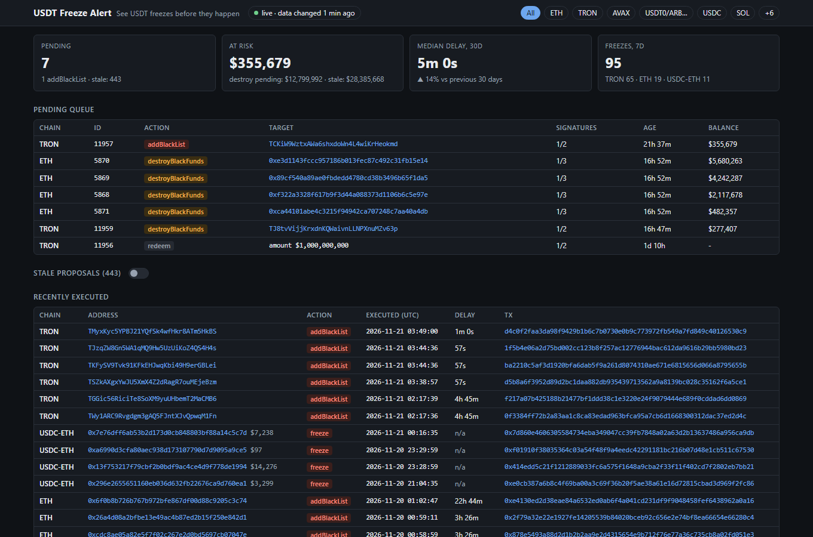
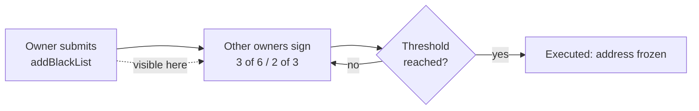

<p align="center"></p>

<p align="center">
  <a href="https://github.com/OWNER/usdt-freeze-alert/actions/workflows/ci.yml"></a>
  <a href="https://github.com/OWNER/usdt-freeze-alert/actions/workflows/watch.yml"></a>
  
  
  
  
</p>

Tether freezes USDT through multisig wallets. The proposal is public before it is executed - this project watches
those queues across chains, stores everything in SQLite, measures how long proposals wait, and renders a static dashboard.

<p align="center">
  
  
  
</p>

<p align="center">
  <a href="assets/dashboard-dark.png"></a>
  <a href="assets/dashboard-light.png"></a>
</p>

## How a freeze happens



The window between *submitted* and *executed* is the early warning. Median is hours on Ethereum and TRON; about 3% of
Ethereum executions land in the same block and cannot be seen coming.

## Coverage

| Mechanism | Chains |
|---|---|
| **On-chain pending** (multisig contract) | Ethereum, TRON, Avalanche, Celo*, Kaia*, Kava*, NEAR, Aptos, TON* |
| **Safe API pending** (off-chain, not guaranteed) | USDT0 on Arbitrum, Polygon, Plasma, Mantle, Optimism, Monad, Unichain, Stable, Morph, Ink, HyperEVM, Berachain |
| **Executed only** (no queue exists) | USDC on Ethereum, USDC and USDT on Solana |

\* delays are `n/a`: no reliable timestamps from public indexers.

## Quick start

```bash
pip install requests
export ETHERSCAN_API_KEY=...        # required for Ethereum history
python -m freezewatch run           # update + stats + site/index.html
```

`python -m freezewatch backfill --chain all` fetches full history (resumable). `run --loop --interval 60` is a local daemon.
`python -m pytest` runs the offline test-suite.

## Run it on GitHub Actions

Fork, add secrets, enable Actions. A cron job runs every 10 minutes and force-pushes **one orphan commit** with
`data/` and `site/` to the `data` branch, so `main` stays code-only and history never grows. The dashboard is
published to Pages from that branch only when something changed.

| Secret | Required | Purpose |
|---|---|---|
| `ETHERSCAN_API_KEY` | yes | Ethereum and USDC logs (Etherscan V2) |
| `TRONGRID_API_KEY` | no | faster TRON reads (public limit is 3 req/s) |
| `SAFE_API_KEY` | no | Safe Transaction Service |
| `TONAPI_KEY` | no | tonapi.io |
| `ETH_RPC_URL`, `SOLANA_RPC_URL` | no | your own RPCs (the public Solana RPC is very slow) |
| `TG_BOT_TOKEN`, `TG_CHAT_ID` | no | Telegram alerts: new proposal, quorum-1, executed, new freeze, new chain for an address |

Seed the `data` branch once from a local run (see the commands in the release notes), or let the first runs build it.

## Limits worth knowing

- TRON execution time is inferred from confirmations (the multisig emits no queryable events); verified against on-chain state in batches.
- Safe queues live off-chain: a signer can skip them, so "no proposal" does not mean "no freeze".
- Solana freezes a token account, not the wallet; Solana USDT history fills gradually on the public RPC.
- Not financial advice.

## Data and attribution

Everything is read from public chain data and APIs. Delays were cross-checked against
[BitOK's tether-blacklist-research](https://github.com/BitOKorg/tether-blacklist-research) (bitok.org, CC BY 4.0):
Ethereum matches on 2251 of 2251 shared proposals, TRON on 7204 of 7204. No BitOK data is included in this repository.

## License

MIT. See [LICENSE](LICENSE) and [CHANGELOG](CHANGELOG.md).
