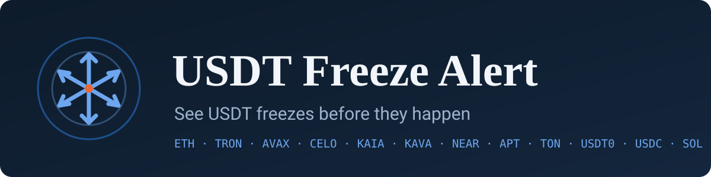
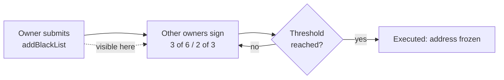
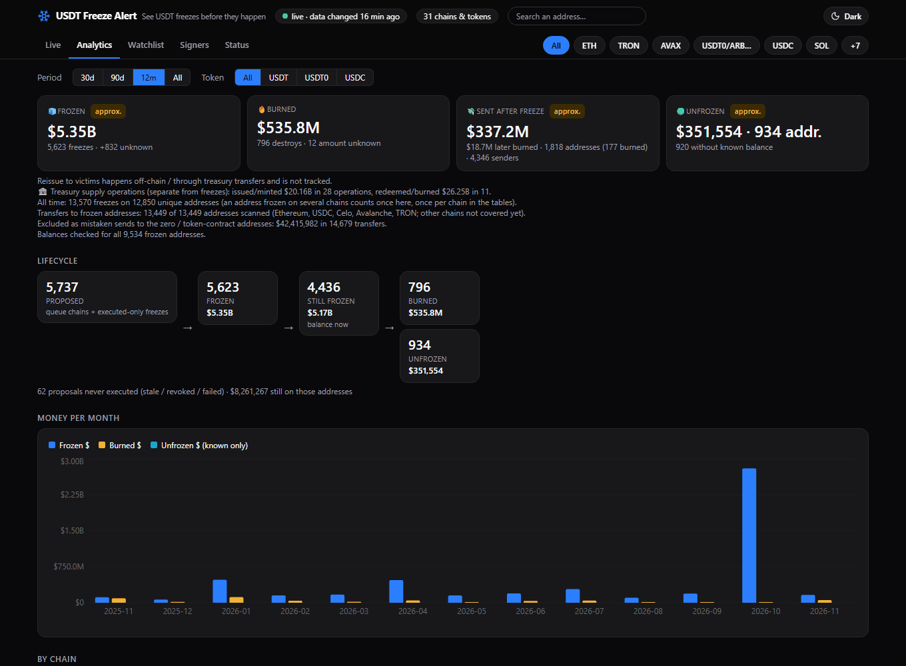

<p align="center"></p>

<p align="center">
  <a href="https://github.com/prettydeath/usdt-freeze-alert/actions/workflows/ci.yml"></a>
  <a href="https://github.com/prettydeath/usdt-freeze-alert/actions/workflows/watch.yml"></a>
  
  
  
  
</p>

Tether freezes USDT through multisig wallets. The proposal is public before it is executed - this project watches
those queues across chains, stores everything in SQLite, measures how long proposals wait, and renders a static dashboard.

**Live dashboard: https://prettydeath.github.io/usdt-freeze-alert/**

<p align="center">
  
  
  
</p>

<p align="center">
  <a href="assets/dashboard-dark.png"></a>
  <a href="assets/dashboard-light.png"></a>
</p>

## How a freeze happens



The window between *submitted* and *executed* is the early warning. Median is hours on Ethereum and TRON; about 3% of
Ethereum executions land in the same block and cannot be seen coming.

## Coverage

| Mechanism | Chains |
|---|---|
| **On-chain pending** (multisig contract) | Ethereum, TRON, Avalanche, Celo, Kaia, Kava, NEAR, Aptos, TON |
| **Safe API pending** (off-chain, not guaranteed) | USDT0 on Arbitrum, Polygon, Plasma, Mantle, Optimism, Monad, Unichain, Stable, Morph, Ink, HyperEVM, Berachain |
| **Executed only** (no queue exists) | USDC on Ethereum, USDC and USDT on Solana; USDT0 on Flare, Conflux, Sei, MegaETH, Rootstock (from token events) |

For **USDT0** the token's own `BlockPlaced` / `BlockReleased` / `DestroyedBlockedFunds` events are the source of truth for executed freezes, unfreezes and burns (Etherscan V2 or Blockscout APIs). Each event is linked to the Safe transaction that executed it (same tx hash and address) to get the proposal time and a real delay; events without a published Safe proposal are counted as **no public proposal** (delay n/a), e.g. 32 of 41 Arbitrum freezes. Not covered: USDT0 on X Layer (no free log API) and Optimism (explorer API unreachable); other chains returned no events.

## Analytics

<p align="center"></p>

The **Analytics** tab (period 30d / 90d / 12m / all, token filter) answers "how much money is behind the freezes":

- **Frozen $**: burned amount if the address was later destroyed, otherwise its current balance (frozen funds cannot move).
- **Burned $**: exact amount of the `DestroyedBlackFunds` / `DestroyedBlockedFunds` event.
- **Sent after freeze**: transfers to an address *while it was blacklisted* (ETH, USDC, Celo, Avalanche, TRON), with the part **later burned**. Broader than "sent to a blacklisted address and burned at the next destroy" (e.g. BitOK's count), because we count every inflow during the frozen interval. The zero address and token contracts, which Tether blacklists to burn mistaken sends, are excluded. (USDC rejects transfers to blacklisted addresses, so it shows none.)
- **Unfrozen**: count, and $ only where a balance was observed while frozen.
- Balances are filled gradually (`ANALYTICS_BUDGET_SEC` per run); the page shows "balances checked N of M" until complete. Reissue to victims happens off-chain / through treasury transfers and is not tracked.

## Quick start

```bash
pip install requests
export ETHERSCAN_API_KEY=...        # required for Ethereum history
python -m freezewatch run           # update + stats + site/index.html
```

`python -m freezewatch backfill --chain all` fetches full history (resumable). `run --loop --interval 60` is a local daemon.
`python -m pytest` runs the offline test-suite.

## Run it on GitHub Actions

Fork, add secrets, enable Actions. A cron job runs every 10 minutes and force-pushes **one orphan commit** with
`data/` and `site/` to the `data` branch, so `main` stays code-only and history never grows. The dashboard is
published to Pages from that branch only when something changed.

| Secret | Required | Purpose |
|---|---|---|
| `ETHERSCAN_API_KEY` | for Ethereum | Ethereum and USDC logs (Etherscan V2). Without it Ethereum is skipped with a warning. Comma-separated list allowed |
| `TRONGRID_API_KEY` | no | faster TRON reads (public limit is 3 req/s). Comma-separated list allowed |
| `SAFE_API_KEY` | no | Safe Transaction Service. Comma-separated list allowed |
| `TONAPI_KEY` | no | tonapi.io. Comma-separated list allowed |
| `ETH_RPC_URL`, `SOLANA_RPC_URL` | no | your own RPCs (the public Solana RPC is very slow) |
| `TG_BOT_TOKEN`, `TG_CHAT_ID` | no | [Telegram alerts](#telegram-alerts) |

Seed the `data` branch once from a local run (see the commands in the release notes), or let the first runs build it.

Several keys are used round-robin; a rate-limited or invalid key is cooled down and the next one is tried (key values are never logged).

## Telegram alerts

Follow the channel: **[t.me/usdt_freeze_alert](https://t.me/usdt_freeze_alert)**. Alerts are sent by the GitHub Actions job
only (no interactive bot): `TG_BOT_TOKEN` + `TG_CHAT_ID` secrets, nothing is sent without them.

| | Alert |
|---|---|
| 🚨 | **Freeze incoming**: new addBlackList / addToBlockedList proposal with balance, signature bar and usual time-to-execution |
| ⚠️ | **Last signature pending** (needs `required` > 2 or progress beyond the initial signature) |
| 🧊 | **Frozen**: executed, with delay or "no advance notice" |
| 💸 | **Sent to a frozen address**: a transfer (>= `ALERT_MIN_INFLOW`, default $1,000) to an already-blacklisted address; the funds are locked at once |
| 🔥 | **Funds burned**: destroyBlackFunds / destroyBlockedFunds executed |
| 🔗 | **Cross-chain signal**: an address frozen on one chain still holds >= $1,000 on another |
| 🟢 | **Unfrozen** |

Each event is sent once (dedupe table), at most 20 messages per run then one `+N more events` summary, history is never
replayed (the first run on an empty database sends nothing). Optional `ALERT_MIN_BALANCE` filters small proposals.
Preview every template without sending: `python -m freezewatch alert-test` (`--send` posts one test message).

## Limits worth knowing

- **Speed.** Tether now often executes a freeze within 1–2 minutes of the proposal. The GitHub Actions job runs every ~10 minutes, so some proposals reach the channel already executed. True early warning needs a self-hosted poller checking every 10–20 seconds.
- TRON execution time is inferred from confirmations (the multisig emits no queryable events); every proposal is cross-checked against on-chain `executed`.
- Safe queues live off-chain: a signer can skip them, so "no proposal" does not mean "no freeze".
- Solana freezes a token account, not the wallet; Solana USDT history fills gradually on the public RPC.
- Not financial advice.

## Data and attribution

Aggregates behind the **Analytics** tab are published as `site/analytics.json` on the `data` branch (see Analytics above).

Everything is read from public chain data and APIs. Delays were cross-checked against
[BitOK's tether-blacklist-research](https://github.com/BitOKorg/tether-blacklist-research) (bitok.org, CC BY 4.0):
Ethereum matches on 2251 of 2251 shared proposals, TRON on 7204 of 7204. No BitOK data is included in this repository.

## License

MIT. See [LICENSE](LICENSE) and [CHANGELOG](CHANGELOG.md).
